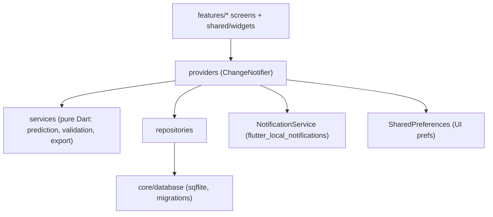

# RedDay — Architecture & Compatibility Plan

## Toolchain (verified on this machine)
| Item | Version | Notes |
|---|---|---|
| Flutter | 3.47.7 stable | Default `minSdk = 24`, `compileSdk/targetSdk = 36` |
| Dart | 3.13.5 | Null safety |
| AGP / Kotlin | 9.1.0 / 2.4.0 | From `flutter create` template |
| Java | 21 (host) | Project compiles to Java 17 bytecode |
| Android SDK | **not installed** | APK builds deferred to user (Android Studio) |

## Dependencies (pinned; Android `minSdk` audited in pub cache)
| Package | Version | Plugin minSdk | Purpose |
|---|---|---|---|
| provider | 6.1.5+1 | n/a | State management (ChangeNotifier) |
| sqflite | 2.4.4+2 | 19 | SQLite persistence |
| shared_preferences | 2.5.6 | 24 | Theme mode + onboarding flag |
| flutter_local_notifications | 22.3.2 | 24 | Local reminders (needs desugaring, compileSdk ≥ 35) |
| timezone | 0.11.2 | n/a | `TZDateTime` for scheduling |
| flutter_timezone | 5.1.1 | 21 | Device IANA zone |
| intl | 0.20.3 | n/a | Date formatting |
| fl_chart | 1.2.0 | n/a | Insights charts |
| file_picker | 13.1.0 | 21 | SAF export (`saveFile`) / import (`pickFile`) — no storage permission |
| path | 1.9.1 | n/a | DB path join |
| sqflite_common_ffi (dev) | 2.4.4 | n/a | Host-side DB tests |

Calendar is **custom-built** (no `table_calendar`) for full control over accessible cell states.

## Layers

## Storage split
- **SQLite** (`redday.db`): `periods`, `daily_logs`, `symptoms`, `daily_log_symptoms`, `app_settings` (cycle + reminder settings → included in export).
- **SharedPreferences**: `theme_mode`, `onboarding_complete` (device UI prefs).

## Theme
Central `AppColors` → `AppTheme.light/dark` (explicit Material 3 `ColorScheme`s) + `RedDayColors` `ThemeExtension` for calendar/semantic tokens. Contrast-driven adjustments are documented in `app_colors.dart`.
